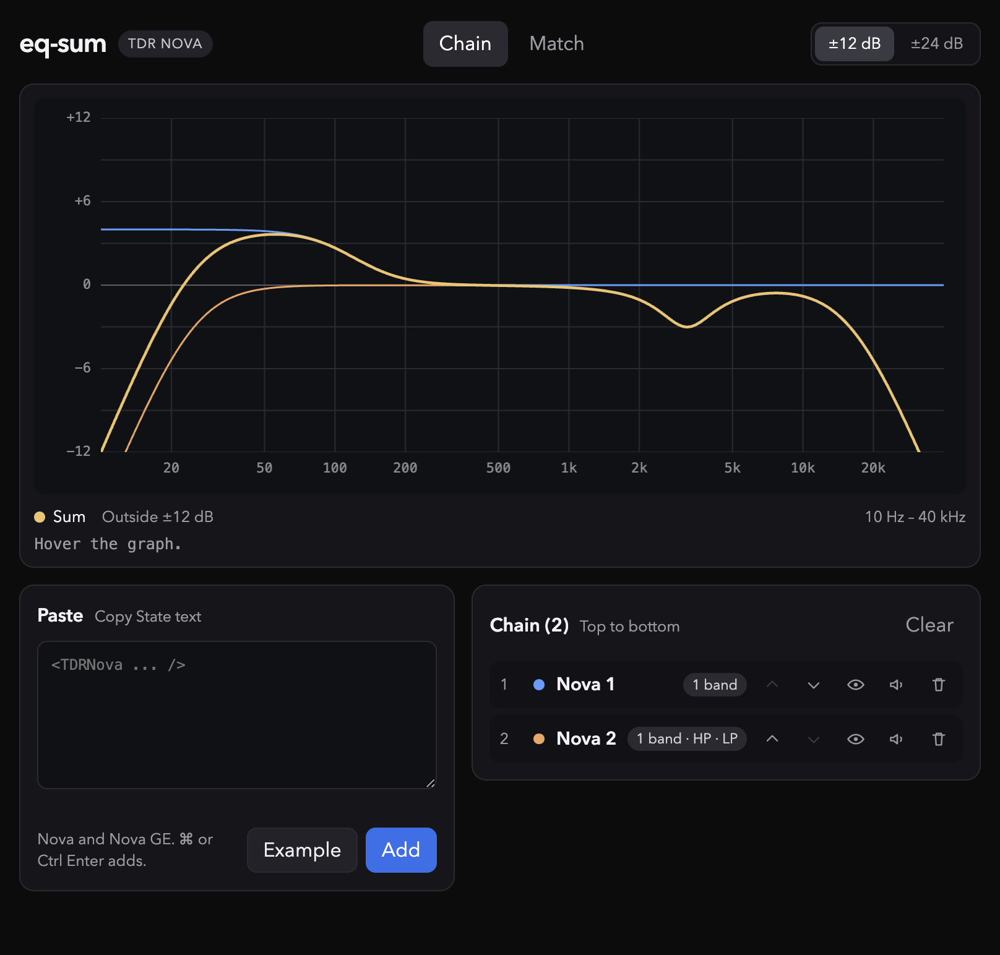
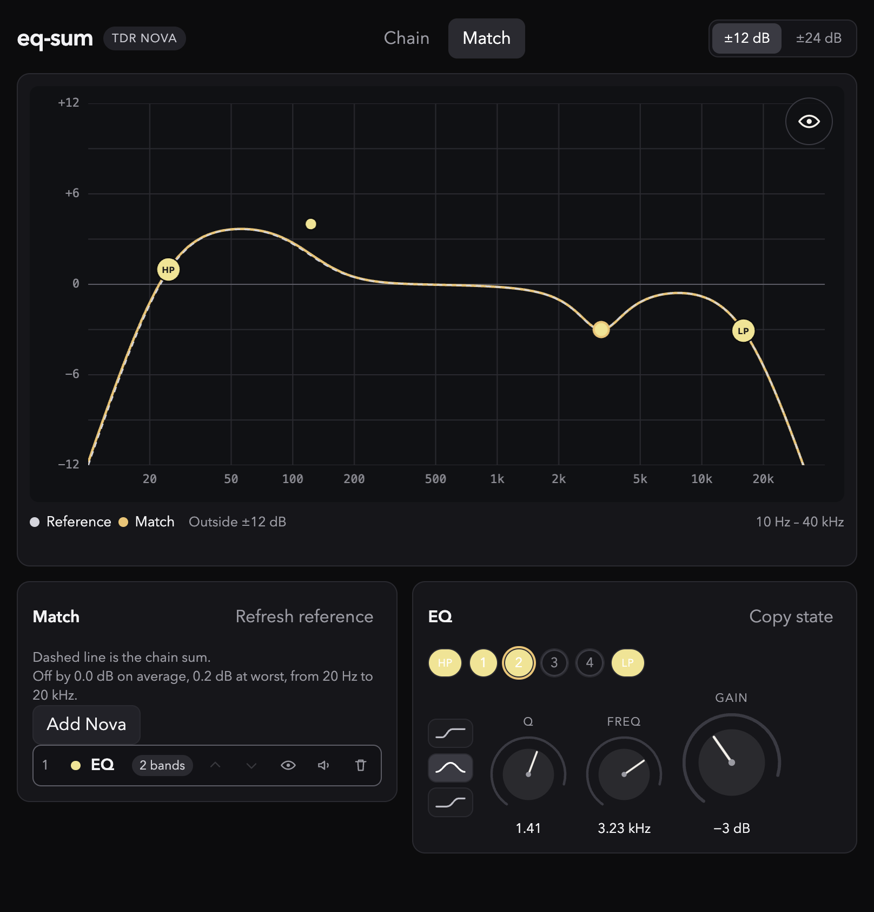
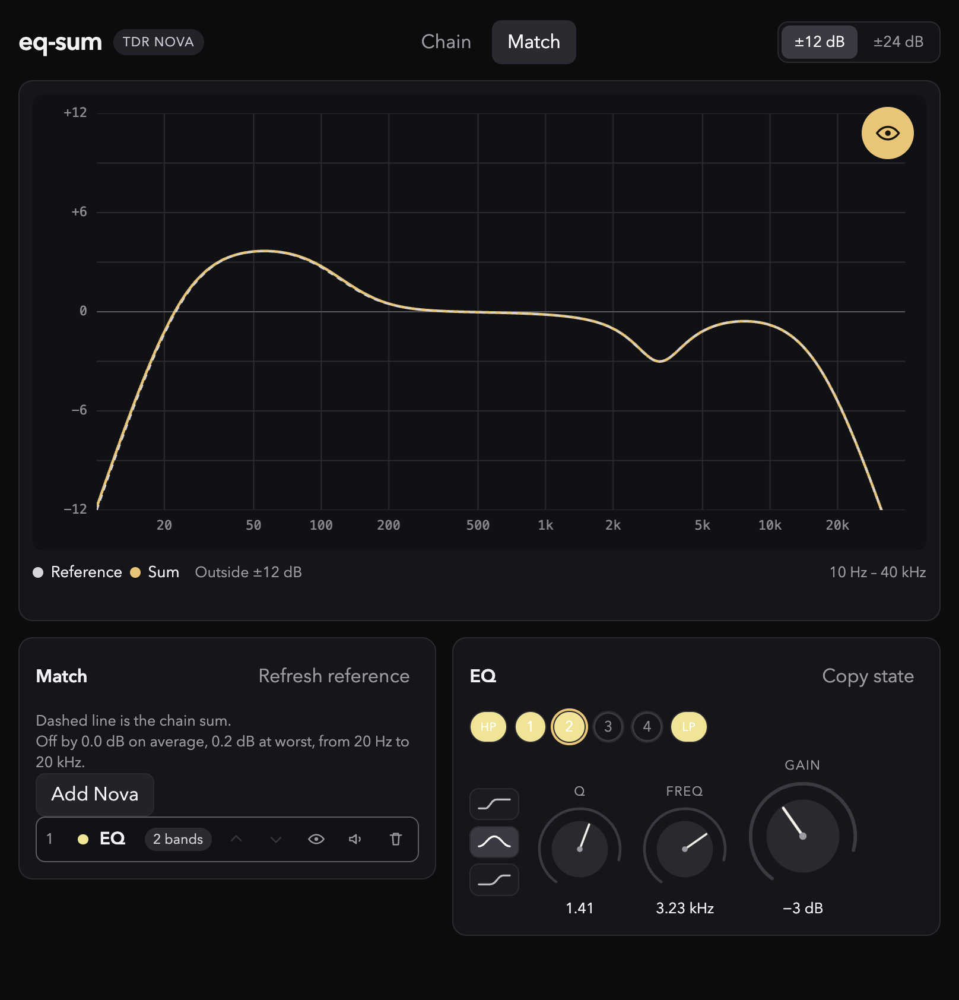

# eq-sum

**See what a stack of TDR Novas adds up to, then fold it back into one, two, or three presets you can paste.**

You already have several [TDR Nova](https://www.tokyodawn.net/tdr-nova/) instances on a channel, or a chain of corrective and tonal Novas, and you want the combined curve. Paste each Copy State, check it against the plugin, and read the yellow sum in dB. On Match, freeze that sum and hand-shape a smaller preset, then copy a Paste State back into the session.

It is tailored for TDR Nova and Nova GE Copy State / Paste State. It runs in the browser. Nothing is uploaded.

eq-sum is an independent project. It is not affiliated with or endorsed by Tokyo Dawn Records, and there is no collaboration. The author would love the TDR Nova team to reach out. This is a feature they would love to see built into TDR Nova, or offered as a separate downloadable plugin.

## Chain



Paste two or more Copy State strings. Each curve stays on the graph, and the yellow line is those curves added in dB.

## Match



Freeze the chain sum as a dashed reference. Shape up to three smaller Novas, four bands each plus a high-pass and a low-pass, by dragging nodes or turning the knobs. Copy state when it is close enough to paste back.

## Preview



Hold the eye at the top-right of the Match graph to hide the nodes and leave only the yellow sum and the dashed reference.

## How to use

1. In TDR Nova, use Copy State.
2. Paste that text here and add it. Repeat for each Nova in the stack. The Example button loads two sample states if you want to try it without a DAW.
3. Check shape, gain, frequency, high-pass, and low-pass against the plugin. Mute, solo, rename, and reorder the chain. Switch the scale between ±12 dB and ±24 dB to match Nova’s magnitude setting.
4. Open Match and refresh the reference if the chain has changed. Add up to three Novas and shape them against the dashed line.
5. Copy state, then Paste State back into Nova.

## Limits

Static curves only. There is no audio processing.

Dynamics, dry mix, bypass, delta, auto-gain, and output gain are called out when a state includes them. They are not drawn into the curve.

Inside one Nova, bands are parallel, so overlapping bands can disagree a little with Nova’s yellow line. Across separate plugins, dB addition is the model once each curve is right.

## Develop

```bash
npm install
npm test
npm run dev
```

MIT license. Copyright 2026 dagjomar.
